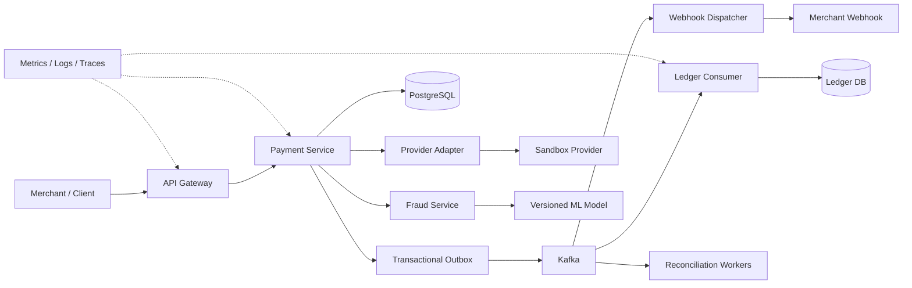

# PayFlow — Distributed Payment Processing Platform

A production-style payment orchestration project focused on idempotency, durable event publication, double-entry accounting, fraud decisioning, reconciliation, and distributed failure handling.

> **Evidence note:** The supplied project summary reports 1,000+ payments/sec at p99 110 ms; zero extra charges across 10,000 repeated requests; reconciliation of 500K payments in 40 seconds detecting all 50 injected errors; zero lost events across 100 forced crashes; and fraud ROC-AUC 0.97 on 284K transactions. Treat these as project-reported results until reproducible scripts, datasets, environment details, and raw outputs substantiate them. Features below are targets until implemented.

## Goals
- Explicit payment state machine and safe retry semantics.
- One logical payment effect for a stable idempotency key within a documented scope/retention period.
- Append-only double-entry ledger with balanced postings and compensating entries.
- PostgreSQL transactional outbox and idempotent Kafka consumers.
- Fraud inference with model/version tracking and explicit fallback policy.
- Reconciliation across internal payment records, provider records, and ledger postings.
- Observable, reproducible load and fault-injection tests.

This is an educational production-style project, not a certified payment processor. Use synthetic data and provider sandboxes. Do not store raw card numbers or CVV.

## Architecture



## Service boundaries
1. **Gateway:** authentication, validation, merchant context, rate limits, request IDs.
2. **Payment:** state machine, idempotency, provider orchestration, timeout/unknown-outcome handling.
3. **Ledger:** append-only journal entries, balanced postings, rebuildable balance projections.
4. **Fraud:** feature validation, inference, thresholds, reason codes, model metadata.
5. **Webhook:** signatures, persisted attempts, retries, backoff, dead-letter handling.
6. **Workers:** outbox relay, reconciliation, provider status polling, reporting.

Prefer a modular monolith first, then extract deployables when independent scaling or failure isolation justifies the operational complexity.

## Repository structure

```text
payflow/
├── README.md
├── ARCHITECTURE.md
├── ROADMAP.md
├── CONTRIBUTING.md
├── pyproject.toml
├── Dockerfile
├── compose.yaml
├── Makefile
├── .env.example
├── config/{development.yaml,production.example.yaml}
├── db/{migrations,seeds}/
├── docs/
│   ├── api-contracts.md
│   ├── payment-state-machine.md
│   ├── idempotency-and-consistency.md
│   ├── ledger-invariants.md
│   ├── reconciliation.md
│   ├── benchmark-methodology.md
│   ├── threat-model.md
│   ├── operations-runbook.md
│   └── decisions/
├── scripts/
├── src/payflow/
│   ├── common/
│   ├── gateway/{app.py,auth.py,rate_limit.py,schemas.py}
│   ├── payments/{app.py,domain.py,state_machine.py,service.py,repository.py,idempotency.py,provider.py,outbox.py}
│   ├── ledger/{app.py,domain.py,posting.py,repository.py,balances.py,invariants.py}
│   ├── fraud/{app.py,features.py,inference.py,thresholds.py,model_registry.py}
│   ├── events/{schemas.py,producer.py,consumer.py,outbox_relay.py,dead_letter.py}
│   ├── webhooks/{app.py,signer.py,dispatcher.py,retry_policy.py,delivery_store.py}
│   └── reconciliation/{provider_import.py,matching.py,discrepancy.py,reports.py}
├── tests/{unit,integration,contract,property,concurrency,failure,reconciliation,performance}/
├── infra/{docker,kubernetes,terraform,monitoring}/
└── load-tests/{k6-payments.js,scenarios.md}
```

## Quick start

```bash
python -m venv .venv
# Linux/macOS: source .venv/bin/activate
# Windows PowerShell: .venv\Scripts\Activate.ps1
python -m pip install --upgrade pip
pip install -e ".[dev]"
pytest
```

This blueprint is a starting scaffold, not a complete implementation of every service.

## API contract (proposed)

`POST /v1/payments`

Headers:
- `Idempotency-Key`: stable opaque key created by the caller
- `X-Request-ID`: optional correlation ID

```json
{
  "amount_minor": 1299,
  "currency": "INR",
  "payment_method_token": "sandbox_pm_123",
  "capture_method": "automatic",
  "metadata": {"order_id": "order_456"}
}
```

Use integer minor units, not floating-point amounts. Only accept sandbox/provider tokens; never store PAN/CVV.

Other endpoints:
- `GET /v1/payments/{payment_id}`
- `POST /v1/payments/{payment_id}/capture`
- `POST /v1/payments/{payment_id}/cancel`
- `POST /v1/payments/{payment_id}/refund`
- `GET /v1/ledger/entries?payment_id=...` (authorized/internal)
- `GET /health/live`, `GET /health/ready`, `GET /metrics` (internal only)

Same key + same canonical payload should return the original logical result. Same key + different payload should return conflict. Document retention and expiry behavior.

## Critical correctness guarantees

### Idempotency
Scope keys by merchant/account and operation. Store canonical request hash, result reference, status, timestamps, and expiry. Enforce uniqueness in PostgreSQL; application pre-checks and Redis locks alone are not enough. Reuse provider idempotency keys where supported. A provider timeout may mean the outcome is unknown—query/reconcile rather than blindly retrying a charge.

### Transactional outbox
Commit payment state and outbox event in one PostgreSQL transaction. The relay can publish twice if it crashes after Kafka publish but before marking the row delivered. Therefore use stable event IDs and idempotent consumers. This is durable at-least-once delivery with deduplication, not universal exactly-once execution.

### Double-entry ledger
Each journal transaction must balance debits and credits per currency. Posted entries are append-only; corrections use compensating entries. Use integer minor units and validate currency exponents. Balance projections must be rebuildable from the journal.

### Fraud model
Record model version, feature schema version, score, threshold/policy version, decision, and reason codes. Evaluate ROC-AUC alongside PR-AUC, precision/recall, calibration, false-decline rate, latency, and leakage. ROC-AUC alone does not prove production suitability.

### Reconciliation
Match provider records, internal payment states, and ledger postings. Classify missing records, amount/currency mismatches, duplicates, stale/unknown states, and refund mismatches. Reruns must be idempotent and auditable.

## Observability
Track payment rate/outcomes, idempotency replays/conflicts, provider latency and unknown outcomes, outbox age, Kafka lag, duplicate events, ledger invariant violations, reconciliation discrepancies, fraud inference latency/model version, p50/p95/p99, throughput, and error rates. Never log secrets or unnecessary payment data.

## Fault-injection scenarios
1. Crash after DB commit but before HTTP response.
2. Crash outbox relay after Kafka publish but before marking delivered.
3. Duplicate an event and verify consumer idempotency.
4. Pause/kill a Kafka consumer.
5. Simulate provider timeout after request transmission.
6. Make webhook receiver return 500, timeout, or rate-limit.
7. Run concurrent same-key requests with matching and mismatching payloads.
8. Make fraud inference unavailable.
9. Import duplicate/wrong-amount/wrong-currency provider records.
10. Interrupt database connectivity in a local test environment.

For each failure, define the invariant, inject the failure, inspect state, collect metrics, and save the result.

## Security boundaries
Use synthetic data and sandbox tokens. Do not claim PCI DSS compliance. Use TLS, least-privilege DB roles, merchant-scoped authorization, signed webhooks, replay protection, secret management, request limits, safe webhook URL validation (SSRF prevention), dependency pinning, and container scanning.

## Success criteria
Demonstrate safe retries, payload conflicts, balanced ledger postings, duplicate-safe event delivery, unknown provider outcomes, reconciliation detection, reproducible fraud evaluation, load dashboards, and a documented recovery/rollback procedure.
